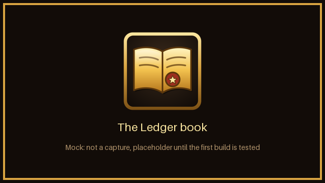
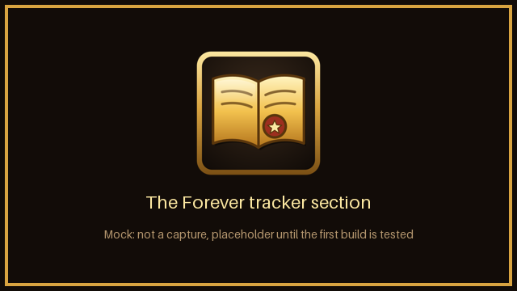
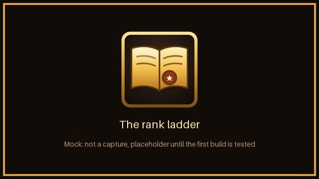

<p align="center"></p>

<h1 align="center">Ledger Forever</h1>

<p align="center">
One progress book for WoW: Forever: daily orders, a stamp for every zone story you finish, and a cosmetic rank.<br>
<a href="https://github.com/cjber/ledger-forever/actions/workflows/ci.yml"></a>
<a href="https://github.com/cjber/ledger-forever/releases/latest"></a>
<br><br><a href="https://github.com/sponsors/cjber"></a> <a href="https://ko-fi.com/cjber"></a>
</p>

Ledger Forever is one progress book for WoW: Forever: daily orders drawn from what you are doing, a wax stamp for every zone whose story you finish, and a cosmetic rank ladder.

## Known limitations

This is a first release: the addon registers with ForeverCore and answers `/ledger`, and the book itself is still to come. Rewards are cosmetic only, and nothing is sent to other players.

- Which quests make up a zone's story comes from QuestieDB, so stamps need Questie or QuestieDB installed.

<p align="center"></p>

The book lists your orders, stamps and rank in one place.

<p align="center"></p>

The three orders sit in the Forever column of the objective tracker.

<p align="center"></p>

Marks from orders and stamps fill the cosmetic rank ladder.

## Features

- **Daily orders.** Three short orders a day drawn from the level, zone and work you are already doing.
- **Zone stamps.** A wax stamp for every zone whose story quests you have finished.
- **Rank ladder.** Marks from orders and stamps raise a cosmetic rank.
- **Tracker section.** Your orders in the shared Forever column of the objective tracker.


## Install

Install it from CurseForge once it is published, or download the zip from [Releases](https://github.com/cjber/ledger-forever/releases). To install the zip by hand, extract the `LedgerForever` folder into `World of Warcraft/_forever_/Interface/AddOns/`. It carries its own copy of ForeverCore, so nothing else is needed.

## Usage

Type `/ledger` or click the addon's icon in the addon compartment to open the book. Every option lives under the Forever addons page in the game's settings.

- `/ledger` opens the book.
- `/ledger report` shows a report to copy into a bug report.
- `/ledger issue` shows a filled-in GitHub issue link to report a bug or request a feature.

For a bug report, paste `/ledger report`.

Translated into German, Spanish, French, Korean, Brazilian Portuguese, Russian and Chinese by machine. Corrections are welcome as a pull request or through the [translation form](https://github.com/cjber/ledger-forever/issues/new?template=translation.yml), and [Locales](https://github.com/cjber/ledger-forever/tree/main/Locales) has the template.

<!-- forever-family:start -->

## The Forever addons

Each one works on its own, and they work together when you install more than one.

| Addon | What it does | Issues |
|---|---|---|
| [Shortest Path Forever](https://www.curseforge.com/wow/addons/shortest-path-forever) | Plans journeys on foot, by air, by sea and through portals, with directions in the tracker. | [Issues](https://github.com/cjber/shortest-path-forever/issues) |
| [Adventure Guide Forever](https://www.curseforge.com/wow/addons/adventure-guide-forever) | Suggests quests for your level and routes you from one to the next. | [Issues](https://github.com/cjber/adventure-guide-forever/issues) |
| [SkillUp Forever](https://www.curseforge.com/wow/addons/skillup-forever) | Shows skill-up chances, recipe costs and levelling routes in the Professions window. | [Issues](https://github.com/cjber/skillup-forever/issues) |
| [Legacy Forever](https://www.curseforge.com/wow/addons/legacy-forever) | Shows your unfinished Legacy challenges on the world map and tracks the ones you choose. | [Issues](https://github.com/cjber/legacy-forever/issues) |
| [Tweaks Forever](https://www.curseforge.com/wow/addons/tweaks-forever) | Adds quest automation, rare alerts and merchant options to the game's settings. | [Issues](https://github.com/cjber/tweaks-forever/issues) |
| [Field Guide Forever](https://www.curseforge.com/wow/addons/field-guide-forever) | Keeps a cosmetic journal of the creatures you kill, zone by zone. | [Issues](https://github.com/cjber/field-guide-forever/issues) |
| [Commissions Forever](https://www.curseforge.com/wow/addons/commissions-forever) | Lists your commission turn-ins, the materials in your bags and the next NPC to visit. | [Issues](https://github.com/cjber/commissions-forever/issues) |
| [Macro Assist Forever](https://www.curseforge.com/wow/addons/macro-assist-forever) | Adds a macro window with every macro in one list, a mono editor with live checks, and history. | [Issues](https://github.com/cjber/macro-assist-forever/issues) |

Bug reports, feature requests and pull requests are welcome on each addon's GitHub. Everyone whose report or idea ships is thanked by name on the Thanks page in game, in the store page and in the changelog, unless they ask not to be.

For help, ideas and each day's release notes, join [cjber's Workshop on Discord](https://discord.gg/FpHugGxRJY).

<!-- forever-family:end -->

## Development

```sh
python3 tools/doctor.py        # every tool pin, with a fix for each problem
python3 tools/gate.py          # the fast local gate; set FOREVER_CORE to a forever-core checkout in a worktree
tools/typecheck.sh             # LuaLS and the multi-value lint; CI runs it in full
```

Install LuaLS, Python 3.12+ and Git before running `tools/typecheck.sh`. The first run fetches the pinned WoW API annotations into ignored `.types/`.

**Releasing:** run `python3 tools/changelog.py release X.Y.Z` to gather the `changes/*.md` notes into `## [X.Y.Z] - YYYY-MM-DD`, then `git tag -s vX.Y.Z && git push --tags`, or run the Release workflow.

**Contributing:** read [CONTRIBUTING.md](https://github.com/cjber/.github/blob/main/CONTRIBUTING.md) and this repository's [AGENTS.md](AGENTS.md). Report security problems privately, as [SECURITY.md](https://github.com/cjber/.github/blob/main/SECURITY.md) says.

## Support

The addon is free and stays GPL-3.0. If it saves you time, you can [sponsor me on GitHub](https://github.com/sponsors/cjber), which takes no fees, or [buy me a coffee on Ko-fi](https://ko-fi.com/cjber). For help and each day's release notes, [join me on Discord](https://discord.gg/FpHugGxRJY).

## Credits

<!-- forever-credits:start -->

Thanks to everyone who reports a bug or asks for a feature.

<!-- forever-credits:end -->

## Licence

GPL-3.0-or-later. Every input, its pin and licence, and what ships: [THIRD_PARTY.md](THIRD_PARTY.md).

Made by Cillian Berragan · [cillian.dev](https://cillian.dev) · [GitHub](https://github.com/cjber) · [Twitter](https://twitter.com/cjberragan)

Built with AI assistance.
